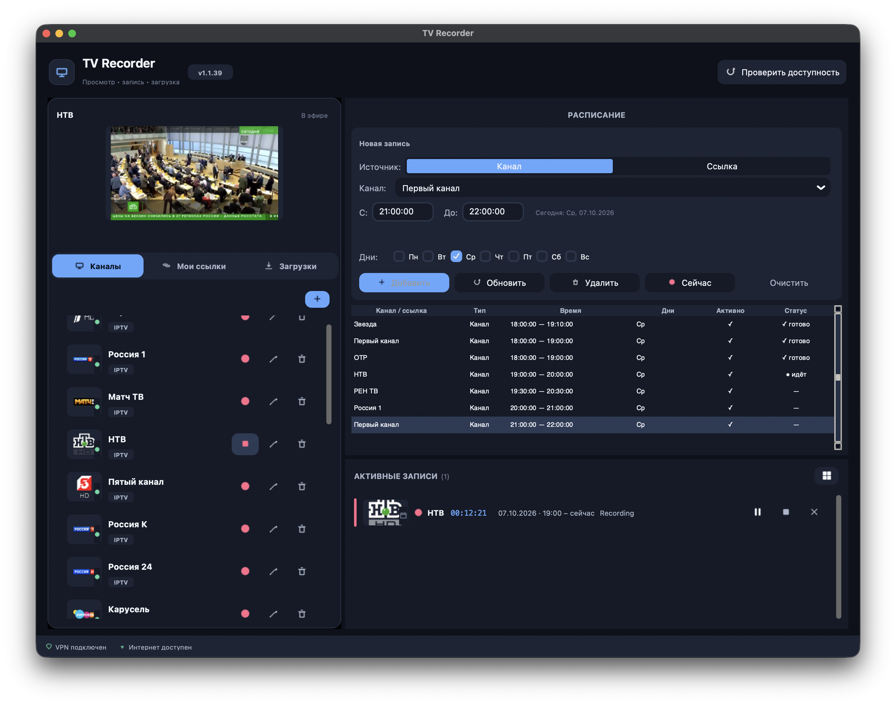

# TV Recorder

> [English version](README.md) · **Русский**

TV Recorder — приложение для macOS, которое позволяет смотреть и записывать
телеканалы, сохранять видео с веб-страниц и запускать запись по расписанию.
Компактный интерфейс работает поверх устойчивого конвейера FFmpeg, рассчитанного
на источники, которые могут временно отключаться или менять качество.



Предпросмотр эфира, расписание и ход записи в одном окне.

## Основные возможности

- **Телеканалы** — импорт любого M3U-плейлиста, предпросмотр, проверка
  доступности и одновременная запись нескольких каналов.
- **Веб-ссылки** — поддержка YouTube, VK, RuTube, Twitch, 1tv.ru, Smotrim,
  «Звезды», встроенных плееров и других сайтов через каскад резолверов.
- **Загрузки** — разовое сохранение видео в выбранном качестве с отображением
  прогресса, скорости, оставшегося времени и корректной отменой.
- **Расписание** — запись каналов и сохранённых ссылок по дням недели и
  временному интервалу с точной остановкой.
- **Резервный захват экрана** — если прямой поток получить невозможно,
  приложение запрашивает разрешение и может записать видимый браузерный плеер.

## Надёжность записи

TV Recorder старается сохранить полезный файл даже при нестабильном источнике:

- переподключается при сетевых, TLS и HTTP-ошибках и зависшем чтении;
- повторяет неудачные HLS-сегменты вместо завершения всей записи;
- выбирает практичный вариант качества из HLS-плейлиста;
- начинает прямой эфир рядом с актуальным краем, не используя устаревшие
  DVR-сегменты;
- проверяет результат через `ffprobe` и различает **завершено**,
  **сохранено частично** и **ошибка обработки**;
- корректно завершает FFmpeg, загрузки, предпросмотр, таймеры и браузер.

Невозможно восстановить данные, которые источник не передал совсем. Кроме
того, подписанная ссылка может истечь во время очень долгой записи, но короткие
обрывы и повреждённые сегменты обрабатываются автоматически.

## Защита незавершённых записей

Во время записи приложение сохраняет фрагментированный MP4 с окончанием
`.recording.mp4`. После остановки собирается обычный MP4 с `faststart`:
для прямых потоков видео и звук копируются без перекодирования.
Временный файл удаляется только после проверки и сохранения результата.

После аварийного выхода при следующем запуске появляется предложение
восстановить незавершённые записи. Можно отказаться и вернуться к ним при
следующем запуске. При ошибке обработки исходный файл сохраняется;
существующие итоговые файлы не перезаписываются. Последний незавершённый
фрагмент при аварии может быть потерян.

На время сборки требуется место ещё для одной копии записи. Автоматическое
восстановление распространяется на записи, созданные этой версией механизма.
Запись экрана с ускорением по-прежнему требует перекодирования для
восстановления нормальной скорости. Готовое установленное приложение
получит изменения после новой сборки.

## Контроль места на диске

Перед записью и загрузкой приложение проверяет выбранную папку реальной
пробной записью, затем повторяет проверку свободного места перед запуском
FFmpeg. Во время работы свободное место проверяется примерно раз в секунду.

- При остатке меньше **3 ГиБ сверх резерва сборки** появляется предупреждение.
- При остатке меньше **1 ГиБ сверх резерва сборки** задача останавливается.
- Резерв учитывает размеры временных записей на том же диске, включая
  параллельные задачи в текущем экземпляре приложения. Для ускоренного
  захвата экрана учитывается увеличение длительности итогового файла.
- После остановки оставшийся запас используется для завершения MP4.
  Перед сборкой дополнительно проверяется место для копии плюс 256 МиБ.
  При нехватке места временная запись сохраняется для восстановления.

Загрузка, остановленная из-за нехватки места, не удаляется как отменённая
пользователем: приложение проверяет файл и показывает частичный результат
либо ошибку обработки. Отсутствующая папка и смена тома во время записи
также вызывают остановку. Резкое отключение диска или быстрое заполнение
другой программой может опередить очередную проверку.

## Контроль зависаний и восстановление эфира

Приложение читает структурированный прогресс FFmpeg: время записанного
контента и число выходных байтов. Повтор одинаковых значений не считается
продвижением. На первое продвижение отводится до 90 секунд; если уже
работавший поток не продвигается 60 секунд, текущая часть останавливается.
После 10 секунд без продвижения интерфейс показывает «Переподключение».
Обычная пауза не считается зависанием.

Для прямой записи **телеканалов** предусмотрено до трёх автоматических
перезапусков с задержками 2, 5 и 10 секунд. Предыдущая часть сохраняется,
следующие получают окончания `_part002.mp4`, `_part003.mp4` и так далее.
В интерфейсе остаётся одна задача; кнопка остановки работает и во время
ожидания следующей попытки. Части не объединяются автоматически: между
ними возможен пропуск эфира, поэтому итог помечается как частичный.

Время окончания расписания сохраняется при перезапусках. После него новая
часть не запускается. Планировщик не создаёт новую цепочку поверх исчерпанного
лимита; неудачная подготовка источника до запуска также ограничена четырьмя
попытками на одно окно расписания.

Готовые ролики в «Моих ссылках» и браузерный захват контролируются на зависание,
но автоматически не запускаются с начала. Остановка пользователем, выход
из приложения и нехватка места отменяют восстановление. Приложение не может
вернуть эфир, который источник не передал; обновление истёкших подписанных
ссылок не гарантируется.

## Пауза прямого эфира и объединение частей

Для телеканала кнопка паузы корректно завершает текущую часть и закрывает
сетевое чтение. В интерфейсе появляется **«Пауза»** и видна подсказка, что прямой эфир пропускается.
Кнопка продолжения запускает новую часть; HLS открывается с самого свежего
сегмента. Быстрое «Пауза → Продолжить» дожидается сохранения прежней части.
Паузы не расходуют попытки восстановления после сетевых сбоев.

Эфир во время паузы не записывается. Время окончания расписания не сдвигается:
если оно наступило на паузе, запись завершается. Остановка и выход также
отменяют продолжение. Для готовых роликов и захвата экрана сохраняется
прежний механизм паузы процесса.

После завершения записи приложение **автоматически собирает один итоговый
MP4** из пригодных частей, без ручного нажатия кнопок. Результат получает
окончание `_joined.mp4`; уведомление и кнопка папки указывают на него.
Объединение выполняется без перекодирования, если параметры видео и звука
совместимы. Исходные части сохраняются, существующие файлы не перезаписываются.
Если автоматическая сборка не удалась, причина видна в подробностях и
остаётся кнопка **«Объединить»** для повторной попытки. Во время сборки
показывается «Сборка файла».

Объединение убирает разрыв на шкале времени файла, но не восстанавливает
пропущенный эфир. Итог с обрывами или паузами остаётся частичным; заполнение
пропуска из ТВ-архива автоматически пока не выполняется.

## Проверка полноты и история

Для записей и загрузок с известной ожидаемой длительностью приложение
сравнивает её с длительностью видео. Более длинный звук не скрывает короткую
видеодорожку. Допуск составляет 2% ожидаемой длительности, но не меньше
1 секунды и не больше 5 секунд. При заметном недоборе отображается, сколько
ожидалось, сколько сохранено и сколько секунд не хватает.

Проверяется наличие видео и ожидаемого звука; заметно укороченная звуковая
дорожка тоже приводит к частичному результату. Если длина исходника
неизвестна, точную полноту всего ролика подтвердить нельзя. Проверка
контейнера и длительности не заменяет полного декодирования всех кадров.

Кнопка **«История»** открывает последние 100 сеансов. Нажатие на статус
текущей записи показывает подробности: пути файлов, длительность частей,
наличие дорожек, паузы, переподключения и причины остановки. История сохраняется
между запусками и остаётся после очистки завершённых строк. Используются
атомарная запись и резервная копия каждого сеанса. При аварийном выходе
незавершённый сеанс отмечается прерванным; после восстановления файла его
запись в истории обновляется. История начинается с записей этой версии,
старые журналы автоматически в неё не импортируются.

## Защита от автоматического сна Mac

С первой запущенной записью приложение временно запрещает автоматический
сон системы. Защита сохраняется во время пауз, переподключений и финальной
сборки файла, а после окончания последней записи снимается. Остановка одной
из нескольких записей не снимает защиту остальных. Ручное объединение частей
также защищено до завершения обработки.

При прямой записи телеканала дисплей может гаснуть. При захвате браузерного
плеера дополнительно удерживается включённым дисплей, чтобы захват не
превратился в чёрный экран. После последнего захвата эта дополнительная
защита снимается, даже если прямые записи ещё продолжаются.

Используется системный `caffeinate`; постоянные настройки питания не меняются.
При выходе из приложения защита снимается, при аварийном завершении — тоже,
поскольку привязана к процессу приложения. Если служба недоступна, приложение
предупредит; запись из-за этого не отменяется.

Функция предотвращает автоматический сон во время уже начатого сеанса.
Она не будит заранее уснувший Mac для будущего расписания и не блокирует
принудительный сон. Восстановление оставшейся части расписания после
пробуждения продолжает работать прежним способом.

## Режимы монитора записей

В сетке мониторинга доступен выбор режима; он запоминается между запусками.
Настройка влияет только на миниатюры, качество записываемого видео не меняется.

| Режим | Активных видеозаписей | Обновление | Ширина миниатюры |
|---|---:|---|---:|
| Экономичный — по умолчанию | 1–4 | До 1 кадра/с, по опорным кадрам источника | 220 пикселей |
| Экономичный | 5 и больше | До 1 кадра за 2 секунды | 220 пикселей |
| Обычный | 1–3 | 4 кадра/с | 320 пикселей |
| Обычный | 4–8 | 2 кадра/с | 280 пикселей |
| Обычный | 9 и больше | 1 кадр/с | 220 пикселей |
| Выключен | Любое число | Декодеры миниатюр не запускаются | — |

В экономичном режиме реальная частота зависит от частоты опорных кадров
телеканала: картинка может обновляться реже заданного предела. Сворачивание,
скрытие окна через Map/Unmap и закрытие монитора отключают его видеопотоки;
при возвращении они запускаются заново. Прослушивание скрытого монитора
также останавливается. Завершённые задачи остаются в основной панели и
истории, но больше не занимают плитки активного монитора.

Уменьшение частоты JPEG само по себе не сокращает чтение потока. Экономичный
режим снижает работу декодера, но пока монитор виден, источник читается
отдельно от записи. Подробный встроенный просмотр канала сохраняет прежнюю
плавность; его частота и архивная шкала времени на этом этапе не меняются.

## Как пользоваться

1. Откройте раздел **Каналы**, **Мои ссылки** или **Загрузки**.
2. Включите предпросмотр или начните запись сразу.
3. Выберите источник в панели **Расписание**, чтобы создать повторяющуюся запись.
4. Следите за задачами в панели активных записей или в режиме сетки.
5. Откройте готовый MP4 в Finder кнопкой с папкой.

В собранном приложении записи находятся в
`~/Movies/TV Recorder/recordings`, а загрузки — в
`~/Movies/TV Recorder/downloads`. Папки можно изменить в настройках.

## Установка приложения

**Версия 1.1.48 доступна в виде готового DMG для Mac с Apple Silicon.**
Скачайте [TV Recorder 1.1.48 — DMG](https://github.com/sirdimitry/TV_recorder/releases/download/v1.1.48/TV_Recorder_v1.1.48_Apple_Silicon.dmg)
или откройте [описание релиза и контрольную сумму SHA-256](https://github.com/sirdimitry/TV_recorder/releases/tag/v1.1.48).

Скачайте [последний готовый DMG](https://github.com/sirdimitry/TV_recorder/releases/latest) с GitHub, откройте его и перетащите **TV Recorder** в **Applications**.
На [странице последнего релиза](https://github.com/sirdimitry/TV_recorder/releases/latest) указана актуальная версия и доступен установщик. Приложение
подписано ad-hoc и не нотарифицировано Apple, поэтому при первом запуске
может потребоваться **Control-клик → Открыть**.

Для резервного захвата экрана выдайте разрешение в **Системные настройки →
Конфиденциальность и безопасность → Запись экрана и системного аудио**. Для
записи звука также требуется loopback-устройство, например BlackHole.

## Отзывы и пожелания

Буду рад, если вы установите TV Recorder и попробуете его в работе.
Если приложение вам понравится, пожалуйста, оставьте несколько слов о своём
опыте. Предложения тоже приветствуются: что можно улучшить или какую функцию
вам хотелось бы видеть? Отзывами и идеями можно поделиться в
[GitHub Issues](https://github.com/sirdimitry/TV_recorder/issues).

Если захотите поддержать проект, буду благодарен за ⭐ на GitHub.
Спасибо, что пробуете TV Recorder и помогаете сделать его лучше!

## Запуск из исходников

Требования: macOS 12+, Python 3.12+ и FFmpeg вместе с `ffplay` и `ffprobe`.

```bash
git clone https://github.com/sirdimitry/TV_recorder.git
cd TV_recorder
brew install ffmpeg
python3 -m pip install -r requirements.txt
python3 main.py
```

Если сайт изменился и перестал распознаваться, обновите yt-dlp:

```bash
python3 -m pip install --upgrade yt-dlp
```

## Сборка DMG

```bash
bash packaging/build.sh
bash packaging/make_dmg.sh
```

Готовый файл появится по пути `packaging/TV_Recorder_v<версия>_Apple_Silicon.dmg`.

## Структура проекта

```text
core/       Запись, загрузки, расписание, поиск потоков и хранение данных
gui/        Интерфейс CustomTkinter и браузерный захват
utils/      Настройки, иконки, журнал, сеть и имена файлов
data/       Резервный список каналов и локальные данные
packaging/  Сценарии сборки приложения и DMG
tests/      Регрессионные тесты надёжности
```

## Благодарности

- [FFmpeg](https://ffmpeg.org/) — воспроизведение, запись и проверка файлов.
- [yt-dlp](https://github.com/yt-dlp/yt-dlp) — извлечение веб-видео.
- [IPTVru](https://github.com/smolnp/IPTVru) — один из источников поиска
  каналов в стандартной конфигурации.
- Часть адресов логотипов получена из плейлистов и Wikimedia Commons.

TV Recorder — независимый проект, не связанный с телеканалами или поставщиками
контента. Пользователь самостоятельно отвечает за соблюдение применимых прав и
условий использования.

## Лицензия

MIT — см. [LICENSE](LICENSE).

## Ссылки Яндекс Видео / Mail.ru

Ссылки `yandex.ru/video/preview/<id>` автоматически раскрываются до сайта
выбранного ролика. Поддерживаются старые адреса `video.mail.ru` и двойной
слеш в `my.mail.ru`. Качество Mail.ru показывается по данным источника.
Если Яндекс вместо источника отдаёт капчу, используйте прямую ссылку на видео.

Новое правило Яндекса дополняет прежний обработчик yt-dlp: если новая
разметка не найдена, исходная ссылка обрабатывается прежним способом.


## Карточки записей

Панель различает подключение, запись, переподключение, сохранение MP4, проверку
файла и сборку единого MP4. В карточке видны размер, части, повторы, паузы,
свободное место на диске и причина проблемы. Во время записи размер учитывает
исходные части; после объединения показывается размер итогового MP4.
Предупреждения о диске остаются в панели и нижней строке состояния.

Фильтры «Все», «Активные» и «Требуют внимания» помогают работать с несколькими
записями. «История» и кнопка «i» открывают подробности внутри панели, кнопка
«Назад» возвращает к записям. Задача остаётся активной до окончания проверки
файла; недоступные на текущем этапе действия отключены.


## Одно основное окно

Монитор, настройки, сведения о программе и формы добавления/редактирования
открываются страницами внутри основного окна. Кнопка «← Назад» закрывает страницу;
при возврате сохраняются выбранный раздел и состояние рабочего пространства.
Несохранённый ввод формы при выходе со страницы отменяется. Предупреждения и
подтверждения также встроены в окно. Нажатие миниатюры ссылки использует встроенный
предпросмотр вместо отдельного ffplay.

Системные диалоги выбора файлов/папок остаются стандартными. Режим записи экрана
по-прежнему открывает браузер с исходным видео: его окно нужно для захвата и не
является дополнительным разделом управления приложением.

## Разработка и проверка сборки

```bash
python3 -m venv .venv
.venv/bin/python -m pip install -r requirements.txt -c requirements/tested-constraints.txt
.venv/bin/python -m unittest discover -s tests -v
.venv/bin/python -m pip install -r requirements/build.txt -c requirements/tested-constraints.txt
PYTHON_BIN="$PWD/.venv/bin/python" bash packaging/build.sh
```

`requirements.txt` содержит зависимости приложения; инструменты PyInstaller
устанавливаются отдельно. `requirements/tested-constraints.txt` фиксирует прямые
версии проверенного окружения, но не является полным lock-файлом транзитивных
зависимостей. GitHub Actions запускает проверки на macOS после push/PR; добавление
workflow само по себе не означает успешного выполнения CI.

Для обычного DMG нужны зависимости `packaging/requirements.txt`. Параметр
`DMG_SIMPLE=1` создаёт тестовый DMG без оформления Finder. Обоим вариантам нужны
доступные системные средства создания образов macOS. Кэш PyInstaller размещается
внутри папки сборки; `PYTHON_BIN` задаёт Python для обоих скриптов.

Переменная окружения `TV_RECORDER_HOME` задаёт отдельную папку данных, логов и медиа
для тестирования, сохраняя ресурсы приложения в исходной папке/бандле. Не указывайте
для тестового профиля рабочую папку пользовательских данных.


## Пауза загрузки YouTube (1.1.50)

Для новых загрузок полного видео YouTube доступны «Пауза» и «Продолжить».
Пауза завершает передачу и сохраняет временные дорожки/части. При продолжении
приложение заново получает адреса видео и докачивает те же форматы через yt-dlp.
После исчерпания автоматических повторов задача остаётся на паузе до ручного
продолжения. После перезапуска приложения незавершённые задачи также восстанавливаются
на паузе — сеть не запускается без нажатия «Продолжить».

Во время сборки и проверки MP4 пауза недоступна. Итоговый файл публикуется после
проверки видео, звука и длительности. «Отменить» удаляет временные части после
подтверждения; «Пауза» сохраняет их. Не удаляйте папки `.tv-download-…` рядом
с загрузкой до её завершения: они нужны для докачки и удаляются после успеха.

Этот режим не применяется к прежним неполным MP4, эфиру, другим сайтам и загрузкам
обрезанного фрагмента. При изменении форматов продолжение отклоняется; временные
данные сохраняются. Возможность докачки зависит от ответа источника на Range:
если он не поддерживает продолжение, yt-dlp может начать соответствующую дорожку
заново. Автоматическая проверка локального Range-сервера не заменяет проверку
реальной доступности YouTube из вашей сети.


## Навигация и прогресс (1.1.51)

Разделы «Эфир и записи», «Архив», «Мои ссылки» и «Загрузки» находятся в одном
верхнем ряду. Вложенного переключателя больше нет. Загрузки занимают доступную
рабочую область без превью; пауза и продолжение действуют как в 1.1.50.

Полоса YouTube показывает общий прогресс выбранных видео- и аудиодорожек,
скачанный и общий объём, скорость и оценку оставшегося времени. Оценочные размеры
и проценты отмечаются `~`. Если размер одной из дорожек неизвестен и не может быть
оценён, вместо выдуманного процента остаётся индикатор активности и счётчик байт.
До проверки готового MP4 прогресс ограничен 99%: завершение передачи ещё не
означает завершения обработки. После докачки форматы и конечный файл проверяются
прежним способом.
